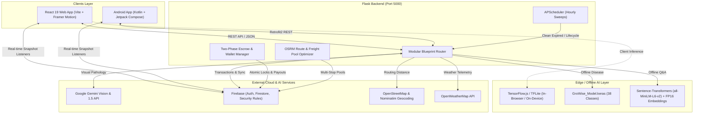

# 🌾 GroWise: Next-Gen Agricultural Intelligence & Direct Trade Platform

<div align="center">

```
   ______              _       ___           
  / ____/________ _   | |     / (_)____  ___ 
 / / __/ ___/ __ \ | /| | /| / / / ___/ / _ \
/ /_/ / /  / /_/ / |/ | |/ |/ / (__  ) /  __/
\____/_/   \____/|__/|__/|__/_/____/   \___/ 
```

**Empowering Farmers, Eliminating Intermediaries, Rescuing Produce, and Revolutionizing Agritech.**

[](https://github.com)
[](https://flask.palletsprojects.com)
[](https://firebase.google.com)
[](https://deepmind.google/technologies/gemini)
[](https://tensorflow.org)
[](LICENSE)

</div>

---

## 📑 Table of Contents
1. [Project Overview](#1-project-overview)
2. [Key Features](#2-key-features)
3. [Technology Stack](#3-technology-stack)
4. [Project Architecture](#4-project-architecture)
5. [Project Folder Structure](#5-project-folder-structure)
6. [Installation Guide](#6-installation-guide)
7. [Environment Variables](#7-environment-variables)
8. [Running the Project](#8-running-the-project)
9. [AI & Deep Learning Modules](#9-ai--deep-learning-modules)
10. [Firebase Integration & Security](#10-firebase-integration--security)
11. [API Documentation](#11-api-documentation)
12. [UI & Feature Walkthrough](#12-ui--feature-walkthrough)
13. [Troubleshooting & FAQs](#13-troubleshooting--faqs)
14. [Performance & Optimization](#14-performance--optimization)
15. [Security Architecture](#15-security-architecture)
16. [Deployment Guide](#16-deployment-guide)
17. [Future Enhancements](#17-future-enhancements)
18. [Contributors](#18-contributors)
19. [License](#19-license)
20. [Acknowledgements](#20-acknowledgements)
21. [Appendix & Dependency Reference](#21-appendix--dependency-reference)

---

# 1. Project Overview

**GroWise** is a full-stack, enterprise-grade agricultural ecosystem designed to bridge the structural divide between farmers, consumers, logistics drivers, NGOs, and platform administrators. Built on top of a modular Flask REST backend, a reactive web frontend (React 19, Vite, Framer Motion), a native Android application (Jetpack Compose, Kotlin), and dual AI pipelines (Google Gemini Vision + local PyTorch Sentence-Transformers + TensorFlow Deep Learning), GroWise replaces fragmented supply chains with a transparent, direct farm-to-table platform.

### 🎯 Purpose of the Platform
Traditional agricultural supply chains are burdened by exploitative middlemen, opaque wholesale pricing, post-harvest crop loss, lack of affordable machinery, and delayed diagnostics for plant diseases. GroWise solves these systemic challenges by:
- Eliminating brokerage commission through direct peer-to-peer farmer-to-consumer trading.
- Providing intelligent plant disease detection using multimodal computer vision and localized agronomy recommendations.
- Minimizing food wastage via automated discount lifecycles and an integrated hyperlocal NGO food rescue engine.
- Optimizing freight economics through pooled logistics routing.
- Democratizing heavy equipment access through a localized rental marketplace.

### 👥 Target Users
- **👨‍🌾 Farmers**: List fresh harvests, access AI crop disease diagnosis, generate customized cultivation roadmaps, negotiate deals via chat cards, rent equipment, and organize pooled logistics.
- **🛒 Consumers & Wholesale Buyers**: Discover local farms, negotiate custom orders directly, track live deliveries, and rate produce.
- **🚚 Logistics Drivers**: Accept on-demand delivery trips, pool multiple farmers' loads into aggregated transit routes, and verify deliveries via OTP.
- **🏛️ NGOs & Food Banks**: Rescue near-expiry produce within a 40 km radius at zero produce cost with automated pickup coordination.
- **🛡️ Platform Administrators**: Verify driver credentials, inspect KYC documents (Aadhaar, Darpan ID, RC Book), monitor transactions, and review analytics.

---

# 2. Key Features

```
┌───────────────────────────────────────────────────────────────────────────┐
│                           GroWise Core Features                           │
├───────────────────┬────────────────────┬──────────────────────────────────┤
│ 🌾 Smart Farming  │ 🛒 Direct Trade    │ 🚚 Logistics & Rescue            │
│ • Gemini Doctor   │ • P2P Chat Cards   │ • Pooled Freight Optimizer       │
│ • TF Plant Health │ • Escrow Wallet    │ • 48h Hyperlocal NGO Feed        │
│ • Crop Roadmaps   │ • Rental Hub       │ • OTP-Secured Multi-Stop Transit │
│ • Weather & Soil  │ • Dynamic Pricing  │ • Admin Verification Portal      │
└───────────────────┴────────────────────┴──────────────────────────────────┘
```

### 🔐 1. Multi-Role Authentication & KYC Onboarding
- Role-based registration for **Farmer**, **User/Buyer**, **Driver**, **NGO**, and **Admin**.
- Strict verification pipelines: 12-digit Aadhaar validation for farmers/drivers, NITI Aayog Darpan ID verification for NGOs, and driver license/RC book document uploads.
- Password hashing with per-user salted **Bcrypt** and custom token generation for secure client authorization.

### 🌿 2. AI Crop Doctor & Plant Disease Diagnosis
- **Cloud AI Mode (Gemini Vision)**: Multimodal visual inspection providing botanical species identification, disease classification, severity grading, organic & chemical remedies, watering guidance, and native language output.
- **Offline / Edge Mode (TensorFlow / Keras & TFLite)**: In-browser and on-device deep learning inference using `GroWise_Model.keras` (38 plant pathology classes) and `crop_model.tflite` for low-connectivity rural environments.
- **Diagnostic History Archive**: Persistent audit log with captured imagery, diagnostic timestamps, and actionable growth tips.

### 📅 3. Smart Cultivation Roadmaps & 3-Strike Maintenance
- AI-generated day-by-day cultivation roadmap tailored to specific crops.
- Milestone tracking with progress statuses (Pending, Completed, Missed).
- Automated daily maintenance worker: applies a **3-Strike Rule** to transition neglected crop plans to archived states.

### 🤖 4. AI Deal Negotiator & Agricultural Assistant
- **AI Deal Analyzer**: Uses Gemini to evaluate fair market price brackets ($\text{Min}$ and $\text{Max}$ price/kg) based on crop type, regional market demand, and user perspective.
- **Offline Semantic Chatbot**: High-speed conversational engine powered by PyTorch `sentence-transformers/all-MiniLM-L6-v2` and precomputed FP16 embeddings for offline FAQ and agricultural Q&A.

### 📦 5. Dynamic Inventory & Automated Lifecycle Clearance
- Farmer stock listing with categories, photo uploads, minimum order quantities (MOQ), and harvest/expiry dates.
- Automated lifecycle price slashing:
  - **Fresh Batch**: Standard listing price.
  - **Near Expiry ($\le 94\text{ hours}$)**: Automatic $30\%$ discount applied.
  - **Clearance Sale ($\le 72\text{ hours}$)**: Automatic $50\%$ discount applied.
  - **Active NGO Feed ($\le 48\text{ hours}$)**: Automatically routed to the zero-cost NGO rescue stream.
  - **Expired ($\le 0\text{ hours}$)**: Automated purge from active markets.

### 🤝 6. Direct Marketplace & P2P Chat Deal Negotiation
- Real-time chat system with embedded structured message cards:
  - `INQUIRY_CARD`: Buyer initiates quantity, custom price quote, and delivery mode.
  - `INVOICE_CARD`: Farmer updates and locks pricing, weight, and transport terms.
  - `RECEIPT_CARD`: Confirmed payment escrow with unique pickup & drop OTPs.
  - `RESCUE_CARD` / `DONATION_ORDER_CARD`: Dedicated non-profit rescue workflows.

### 🚚 7. Intelligent Logistics & Crop Pooling Engine
- Dynamic fare calculations utilizing OSRM (Open Source Routing Machine) driving routes and Haversine geodesic math:
  - **Two-Wheeler / Bike**: Loads $\le 20\text{ kg}$, distances $\le 15\text{ km}$ (Base fare ₹30 + ₹10/km).
  - **Three-Wheeler / Auto**: Loads $\le 500\text{ kg}$, distances $\le 40\text{ km}$ (Base fare ₹150 + ₹18/km).
  - **Crop Pooling Hub**: Aggregates multiple smallholder farmer loads into consolidated 400–1000 kg freight pools with optimized multi-stop collection routes.
- Dual OTP verification: Pickup OTP verified at farm gate, Drop OTP verified upon customer delivery.

### 🍲 8. Hyperlocal NGO Food Rescue Pipeline
- Real-time rescue feed discovering surplus and near-expiry crops within a $40\text{ km}$ geodesic radius.
- Dual option transport: Self-Service Pickup (instant pickup OTP) or GroWise Assisted Delivery (wallet-settled delivery fare).
- Atomic inventory reservation preventing concurrent claim collisions.

### 🚜 9. Farm Equipment & Machinery Rental Hub
- Localized peer-to-peer machinery sharing (tractors, tillers, harvesters, sprayers) with hourly and daily rental rates.
- Distance-based spatial filtering, verified owner phone integration, and one-click availability toggle locks.

### 💳 10. Two-Phase Escrow Settlement & Wallet Ledger
- Two-phase commit escrow: Buyer funds are locked in atomic escrow upon order confirmation.
- Safe refunds: Instant wallet restitution on farmer cancellation or delivery timeout ($>10\text{ min}$ at pickup).
- Automated payout splitting: On verified delivery, $100\%$ of crop value is transferred to the farmer's wallet and $100\%$ of transport fare to the driver's wallet.

### 🌦️ 11. Weather Intelligence & OpenStreetMap Geocoding
- Live weather telemetry integrated via OpenWeatherMap API with fallback offline simulation.
- Reverse geocoding via OpenStreetMap Nominatim for human-readable farm addresses.

### 📊 12. Admin Command & Driver Verification Portal
- Comprehensive administrative control center displaying real-time platform metrics, daily deal volume, and driver verification queues.
- Interactive multi-interval charts ($7\text{ Days}$, $1\text{ Month}$, $6\text{ Months}$) using Recharts.
- Driver application review: Approve or reject vehicle registration certificates and licenses, automatically minting unique `GW-Dxxxx` driver IDs.

---

# 3. Technology Stack

### 🖥️ Frontend (Web & Mobile)
| Technology | Version | Purpose |
| :--- | :--- | :--- |
| **React** | `^19.2.8` | Core UI component framework |
| **Vite** | `^8.2.0` | High-speed frontend build tool and development server |
| **React Router DOM** | `^7.18.2` | Client-side routing, protected routes, and role guards |
| **Framer Motion** | `^13.1.0` | Smooth page transitions and UI micro-animations |
| **GSAP** | `^3.15.0` | Advanced timeline animations |
| **Material UI (MUI)** | `^9.3.1` | Base UI components and accessible design elements |
| **Lucide React** | `^1.28.0` | Consistent vector iconography |
| **Leaflet & React-Leaflet** | `^1.9.4` / `^5.0.0` | Interactive map visualization and routing overlays |
| **Recharts** | `^3.10.1` | Administrative dashboard analytics & transaction charts |
| **TensorFlow.js & TFLite** | `^4.22.0` | In-browser client-side offline disease diagnosis |
| **Kotlin & Jetpack Compose** | Android SDK 36 | Native Android mobile application frontend |
| **Retrofit2 & Gson** | `^2.9.0` | Android network client and REST API serialization |
| **OSMDroid** | `^6.1.18` | OpenStreetMap SDK for Android mapping |
| **Coil Compose** | `^2.5.0` | Asynchronous image loading for Android UI |

### ⚙️ Backend & API Layer
| Technology | Version | Purpose |
| :--- | :--- | :--- |
| **Python** | `3.10+ / 3.14 compatible` | Backend runtime environment |
| **Flask** | `^3.1.3` | Lightweight, modular WSGI web framework |
| **Werkzeug** | `^3.1.8` | WSGI utility library and secure file upload handling |
| **APScheduler** | `^3.11.3` | Background task scheduling (hourly cleanups & lifecycles) |
| **Bcrypt & Cryptography** | `^5.0.0` / `^49.0.0` | Password hashing and cryptographic security |
| **PyJWT** | `^2.13.0` | Secure token processing |
| **Python-Dotenv** | `^1.2.2` | Environment configuration management |
| **Requests & HTTPX** | `^2.34.2` / `^0.28.1` | External HTTP client for OSRM, weather, and geocoding |

### 🧠 AI & Machine Learning
| Technology | Purpose |
| :--- | :--- |
| **Google GenAI SDK (`google-genai`)** | Gemini Vision & 1.5/2.0 API for crop pathology and pricing |
| **PyTorch (`torch ^2.1.0`)** | Tensor computation for Sentence-Transformers NLP |
| **Sentence-Transformers (`^3.4.0`)** | `all-MiniLM-L6-v2` dense vector embedding generation |
| **Scikit-Learn (`scikit-learn ^1.4.0`)** | Cosine similarity calculations for semantic search |
| **NumPy (`^1.26.0`)** | Numerical processing of precomputed FP16 embeddings |
| **TensorFlow & Keras (`GroWise_Model.keras`)** | 38-class plant disease classification deep learning model |
| **Pillow (`PIL ^12.3.0`)** | Image preprocessing, resizing (224x224), and normalization |

### 🗄️ Database, Authentication & Cloud
| Technology | Purpose |
| :--- | :--- |
| **Firebase Admin SDK (`^7.5.0`)** | Backend Firestore administration and Custom Token minting |
| **Firebase Client SDK (`^12.17.1`)** | Real-time chat listener, authentication, and cloud storage |
| **Cloud Firestore** | NoSQL document database with transactional atomicity |
| **OpenStreetMap & Nominatim** | Open-source map tiles, routing (OSRM), and reverse geocoding |
| **OpenWeatherMap API** | Real-time weather and temperature telemetry |

---

# 4. Project Architecture

GroWise employs a decoupled **Client-Server-Cloud** architecture centered around real-time synchronization, isolated role boundaries, and dual AI inference pipelines.



### 🔄 Data Flow Summary
1. **User Authentication**: Client credentials pass to `/api/auth/login`, verified against Bcrypt hashes in Firestore; backend returns a Firebase Custom Token.
2. **Crop Diagnosis**: Client uploads an image $\to$ `/api/crop-doctor/ai-diagnose` $\to$ Gemini Vision extracts structured JSON diagnostic schema $\to$ Saved to user's `diagnostic_history` subcollection.
3. **P2P Trade Negotiation**: Buyers send `INQUIRY_CARD` $\to$ Stored in `chats/{chatId}/messages` $\to$ Real-time listener renders interactive deal cards $\to$ Farmer counters with `INVOICE_CARD`.
4. **Order Execution & Escrow**: Buyer confirms deal $\to$ `/api/orders/create_order` executes atomic transaction (locks wallet balance $\to$ decrements inventory $\to$ generates OTPs).
5. **Logistics & Delivery**: Driver accepts load $\to$ Navigates using OSRM $\to$ Enters Pickup OTP $\to$ Enters Drop OTP at destination $\to$ `/api/logistics/complete-delivery` triggers instant dual payout.

---

# 5. Project Folder Structure

```
GroWise/
├── backend/                               # Flask Backend Server
│   ├── ai_engine/                         # AI & Deep Learning Pipelines
│   │   ├── models/                        # Pretrained Neural Network Weights
│   │   │   ├── GroWise_Model.keras        # 38-Class Plant Pathology Model (22.4 MB)
│   │   │   └── class_indices.json         # Label Index Mapping
│   │   ├── answers_min.json               # Agricultural Knowledge Base Q&A
│   │   ├── chatbot_engine.py              # Cosine Similarity Matching Engine
│   │   ├── disease_model_loader.py        # TensorFlow/Keras Inference Loader
│   │   ├── embeddings_fp16.npy            # Precomputed Dense Vectors (18.2 MB)
│   │   ├── gemini_vision.py               # Multilingual Gemini Vision Pipeline
│   │   └── model_loader.py                # SentenceTransformer Cache Manager
│   ├── routes/                            # Modular REST Blueprints
│   │   ├── admin.py                       # Platform Statistics & Driver Verification
│   │   ├── auth.py                        # Signup, Login, and Password Routing
│   │   ├── chat_ai.py                     # Price Advisor & Offline NLP Chat
│   │   ├── crop_doctor.py                 # Disease Diagnosis & History Storage
│   │   ├── cultivation.py                 # AI Roadmap Generation & Maintenance
│   │   ├── deals_routes.py                # Chat Deal State Machine Transitions
│   │   ├── inventory.py                   # Stock Management & Dynamic Lifecycle
│   │   ├── logistics.py                   # Fare Matrix, Pools, & Trip Lifecycle
│   │   ├── ngo_routes.py                  # Hyperlocal 40km Food Rescue Feed
│   │   ├── order_routes.py                # Order Placements & Escrow Locks
│   │   ├── payout_webhook.py              # Automated Post-Delivery Payouts
│   │   ├── profile.py                     # User Profiles & GPS Telemetry Sync
│   │   ├── rental.py                      # Machinery Rental Postings & Search
│   │   ├── reviews.py                     # Farmer Rating & Feedback System
│   │   └── wallet.py                      # Wallet Ledger & Transaction Logs
│   ├── services/                          # Business Domain Services
│   │   └── inventory_service.py           # Atomic Reservation & Stock Deductions
│   ├── scripts/                           # Maintenance Utilities
│   │   └── cleanup_orphan_chats.py        # Database Hygiene Script
│   ├── uploads/                           # Static File Upload Directories
│   │   ├── crop/                          # Crop Image Storage
│   │   ├── diagnosis/                     # Diagnosed Plant Photos
│   │   ├── drivers/                       # Verification Documents (Licenses/RC)
│   │   ├── product_photos/                # Market Inventory Photos
│   │   ├── profiles/                      # User Avatars
│   │   └── rental_photos/                 # Machinery Photos
│   ├── .env.example                       # Backend Environment Template
│   ├── app.py                             # Server Entrypoint & APScheduler Setup
│   ├── firebase_config.py                 # Firebase Admin SDK Client Initialization
│   └── requirements.txt                   # Python Dependencies
│
├── website/                               # React 19 Frontend Web Application
│   ├── public/                            # Static Public Assets
│   ├── src/
│   │   ├── assets/                        # Design Icons, Logos, & Brand Graphics
│   │   ├── components/                    # Reusable React UI Components
│   │   │   ├── ai/                        # AI Assistant Floating Widgets
│   │   │   ├── chat/                      # P2P Interactive Message Cards
│   │   │   ├── common/                    # Notifications & Global Modals
│   │   │   ├── diagnosis/                 # Visual Diagnosis Cards & Loaders
│   │   │   ├── driver/                    # Driver Status Overlays & Waypoints
│   │   │   ├── layout/                    # Navigation Bars, Headers, & Shells
│   │   │   ├── ml/                        # Client-side Offline Crop Doctor
│   │   │   ├── shared/                    # Reusable Form & Action Cards
│   │   │   ├── AiChatModal.jsx            # Universal AI Chat Assistant Dialog
│   │   │   └── ProtectedRoute.jsx         # Role-Based Route Protection Guard
│   │   ├── contexts/                      # React Context Providers
│   │   │   └── AuthContext.jsx            # Global Authentication & Session State
│   │   ├── pages/                         # Application Views & Portals
│   │   │   ├── admin/                     # Admin Dashboard, Lists, & Verification
│   │   │   ├── driver/                    # Driver Portal, Trips, & Wallet
│   │   │   ├── farmer/                    # Farmer Dashboard, Doctor, & Pools
│   │   │   ├── ngo/                       # NGO Donation Hub & Rescue Feed
│   │   │   ├── shared/                    # Deals, Tracking, & Password Reset
│   │   │   ├── user/                      # Consumer Marketplace & Farmer Menus
│   │   │   ├── Login.jsx                  # Multi-Role Unified Login View
│   │   │   ├── Signup.jsx                 # Role-Selective Registration View
│   │   │   └── Splash.jsx                 # Animated Brand Landing Screen
│   │   ├── services/                      # API & Notification Bridges
│   │   │   ├── api.js                     # Axios HTTP Client
│   │   │   └── NotificationService.js     # Native Toast Dispatcher
│   │   ├── App.jsx                        # Client Route Definitions
│   │   ├── main.jsx                       # React DOM Root Bootstrap
│   │   └── index.css                      # Global Stylesheet & Design Tokens
│   ├── .env.example                       # Web Frontend Environment Template
│   ├── package.json                       # NPM Package Dependencies & Scripts
│   └── vite.config.js                     # Vite Bundler Configuration
│
├── frontend/                              # Native Android Application (Kotlin)
│   ├── app/
│   │   ├── src/main/
│   │   │   ├── assets/                    # TFLite Weights & Metadata
│   │   │   │   ├── crop_model.tflite      # On-Device Plant Disease Model
│   │   │   │   ├── disease_metadata.json  # Comprehensive Treatment Metadata
│   │   │   │   └── labels.txt             # 38 Classification Labels
│   │   │   ├── java/com/simats/growise/   # Kotlin Source Code
│   │   │   ├── res/                       # Android XML Drawables & Layouts
│   │   │   └── AndroidManifest.xml        # Android App Manifest & Permissions
│   │   └── build.gradle.kts               # Gradle Build Configuration (SDK 36)
│   └── build.gradle.kts                   # Project-level Gradle Script
│
├── firestore.rules                        # Production Firestore Security Rules
├── firebase.json                          # Firebase Project Configuration
└── README.md                              # Master Repository Documentation
```

---

# 6. Installation Guide

### 📋 Prerequisites
Ensure the following tools are installed on your workstation:
- **Python**: Version `3.10.x` or `3.11.x` (Recommended).
- **Node.js**: Version `18.x` or `20.x+`.
- **npm**: Version `9.x+` or `10.x+`.
- **Git**: Version `2.x+`.
- **Android Studio** *(Optional, only if building the native Android mobile app)*.

---

### 🐍 1. Backend Installation

```bash
# 1. Navigate to the backend directory
cd backend

# 2. Create a virtual environment
python -m venv venv

# 3. Activate the virtual environment
# On Windows (PowerShell):
.\venv\Scripts\Activate.ps1
# On Windows (Command Prompt):
.\venv\Scripts\activate.bat
# On macOS / Linux:
source venv/bin/activate

# 4. Upgrade pip
pip install --upgrade pip

# 5. Install all backend dependencies
pip install -r requirements.txt

# 6. Set up your Firebase service account key
# Place your 'firebase_key.json' service account credentials in the 'backend/' folder
```

---

### 💻 2. Frontend Web Installation

```bash
# 1. Navigate to the website directory
cd ../website

# 2. Install all Node.js dependencies
npm install

# 3. Run post-install patches (if prompted)
npm run postinstall
```

---

# 7. Environment Variables

Create `.env` files in both `backend/` and `website/` by copying the provided `.env.example` templates.

### 🔒 Backend Environment Configuration (`backend/.env`)

```ini
# =================================================================
# GroWise Backend Environment Variables
# =================================================================

# Google Gemini API Key (Required for AI Vision, Crop Doctor, & Chat)
GEMINI_API_KEY=your_gemini_api_key_here

# OpenWeatherMap API Key (Optional - Fallback simulator provided if omitted)
OPENWEATHER_API_KEY=your_openweather_api_key_here

# Flask Application Secret Key
SECRET_KEY=growise_super_secure_production_secret_key

# Backend Server Listening Port
PORT=5000
```

---

### 🌐 Frontend Environment Configuration (`website/.env`)

```ini
# =================================================================
# GroWise Website Environment Variables
# =================================================================

# Firebase Web App SDK Configuration
VITE_FIREBASE_API_KEY=your_firebase_api_key_here
VITE_FIREBASE_AUTH_DOMAIN=your_project_id.firebaseapp.com
VITE_FIREBASE_PROJECT_ID=your_project_id
VITE_FIREBASE_STORAGE_BUCKET=your_project_id.firebasestorage.app
VITE_FIREBASE_MESSAGING_SENDER_ID=your_messaging_sender_id
VITE_FIREBASE_APP_ID=your_firebase_app_id

# Backend REST API Base URL
VITE_API_URL=http://127.0.0.1:5000
```

---

# 8. Running the Project

### 🚀 Development Mode

#### Start Backend Server
```bash
cd backend
# Ensure virtual environment is active
python app.py
```
> The backend server will initialize the background `APScheduler`, load the Sentence-Transformer semantic model, instantiate the disease classifier, and start listening on `http://127.0.0.1:5000`.

#### Start Frontend Web Application
```bash
cd website
npm run dev
```
> The Vite development server will start instantly at `http://localhost:5173`.

---

### 📦 Production Build (Frontend)

```bash
cd website

# Build production bundle
npm run build

# Preview production build locally
npm run preview
```

---

# 9. AI & Deep Learning Modules

GroWise incorporates a multi-tier AI framework designed for both high-precision cloud inference and robust offline edge execution.

```
┌─────────────────────────────────────────────────────────────────────────────┐
│                          Dual AI Architecture                               │
├──────────────────────────────────────┬──────────────────────────────────────┤
│ ☁️ Cloud Multimodal Intelligence     │ 💻 Offline Edge Inference            │
├──────────────────────────────────────┼──────────────────────────────────────┤
│ • Model: Google Gemini Vision        │ • Model: GroWise_Model.keras (38 cl) │
│ • Multi-language agronomic output    │ • TFLite: crop_model.tflite (Android)│
│ • Disease severity & pest analysis   │ • TF.js: In-browser WebAssembly      │
│ • Dynamic deal price recommendation  │ • NLP: all-MiniLM-L6-v2 Embeddings   │
└──────────────────────────────────────┴──────────────────────────────────────┘
```

### 🌿 1. Cloud Gemini Vision Multimodal Pipeline (`ai_engine/gemini_vision.py`)
- **Engine**: Powered by Google GenAI SDK (`gemini-3.6-flash`).
- **Capabilities**: Detects crop diseases, identifies botanical species, differentiates non-plant objects, assesses severity levels (Low, Medium, High, Critical), and provides localized organic & chemical remedies.
- **Multilingual Support**: Prompts dynamically translate the output schema into the user's native language ISO code (e.g., English, Hindi, Tamil, Telugu).

### 🔬 2. Deep Learning Disease Classifier (`ai_engine/disease_model_loader.py`)
- **Architecture**: Deep Convolutional Neural Network saved in Keras format (`GroWise_Model.keras`).
- **Input Pipeline**: Preprocesses input images to $(224 \times 224 \times 3)$ RGB tensors normalized to $[0.0, 1.0]$.
- **Classification Output**: Maps Softmax predictions across 38 crop disease classes via `class_indices.json` (including Apple Scab, Corn Blight, Grape Black Rot, Potato Late Blight, Tomato Early Blight, etc.).

### 💬 3. Offline Semantic Search Chatbot (`ai_engine/chatbot_engine.py`)
- **Model**: `sentence-transformers/all-MiniLM-L6-v2` loaded via PyTorch.
- **Inference Pattern**: Computes a 384-dimensional dense vector for incoming queries and executes vector cosine similarity against `embeddings_fp16.npy` across pre-indexed answers in `answers_min.json`.
- **Zero Latency**: Operates with sub-10ms response time and zero external network dependency.

### 📱 4. Edge TensorFlow Lite Inference (`crop_model.tflite` & TF.js)
- **Web App**: Client-side execution via `@tensorflow/tfjs` and `@tensorflow/tfjs-tflite`.
- **Android App**: Hardware-accelerated neural network execution via `org.tensorflow:tensorflow-lite-gpu` for offline field diagnosis.

---

# 10. Firebase Integration & Security

GroWise utilizes Firebase for real-time document synchronization, client-side authentication, and object storage.

```
┌─────────────────────────────────────────────────────────────────────────────┐
│                       Firestore Database Schema                             │
├───────────────────┬─────────────────────────────────────────────────────────┤
│ Collection        │ Document Structure & Purpose                            │
├───────────────────┼─────────────────────────────────────────────────────────┤
│ users             │ User profile, role, masked Aadhaar/Darpan, coordinates  │
│ └── diagnostic_   │ Subcollection storing user's plant diagnosis history   │
│     history       │                                                         │
│ └── active_crops  │ Subcollection tracking day-by-day cultivation roadmaps  │
│ inventory         │ Farmer produce stock, category, MOQ, discount stage     │
│ orders            │ Placed orders, OTPs, driver assignment, escrow status   │
│ chats             │ Conversation channel between buyer/NGO and farmer       │
│ └── messages      │ Subcollection with deal cards (Inquiry/Invoice/Receipt) │
│ wallets           │ User/Farmer/Driver wallet balances                      │
│ transactions      │ Detailed debit/credit ledger (Escrow Lock, Refund, Pay) │
│ rentals           │ Available agricultural machinery listings               │
│ reviews           │ Farmer ratings, feedback reviews, and timestamps        │
└───────────────────┴─────────────────────────────────────────────────────────┘
```

### 🛡️ Firestore Security Rules (`firestore.rules`)
```javascript
rules_version = '2';
service cloud.firestore {
  match /databases/{database}/documents {
    
    // 1. CHATS: Strictly authorized by participants
    match /chats/{chatId} {
      allow read, write: if request.auth != null && (
        resource.data.userEmail == request.auth.uid || 
        resource.data.farmerEmail == request.auth.uid
      );
    }

    // 2. MESSAGES: Authorized by parent chat document
    match /chats/{chatId}/messages/{messageId} {
      allow read, write: if request.auth != null && (
        get(/databases/$(database)/documents/chats/$(chatId)).data.userEmail == request.auth.uid ||
        get(/databases/$(database)/documents/chats/$(chatId)).data.farmerEmail == request.auth.uid
      );
    }

    // 3. USERS: Readable by authenticated users, writable only by owner
    match /users/{userId} {
      allow read: if request.auth != null;
      allow write: if request.auth != null && request.auth.uid == userId;
    }

    // 4. SHARED COLLECTIONS: Global authenticated access
    match /orders/{orderId} { allow read, write: if request.auth != null; }
    match /wallets/{walletId} { allow read, write: if request.auth != null; }
    match /transactions/{txId} { allow read, write: if request.auth != null; }
    match /inventory/{itemId} { allow read, write: if request.auth != null; }
  }
}
```

---

# 11. API Documentation

The GroWise backend exposes a comprehensive set of RESTful endpoints organized across 15 modular Flask blueprints.

### 🔐 1. Authentication (`/api/auth`)
| Endpoint | Method | Purpose | Auth | Request Example | Response Example |
| :--- | :---: | :--- | :---: | :--- | :--- |
| `/api/auth/signup` | `POST` | Register a new user, farmer, driver, or NGO | None | `{"name":"Ravi Kumar","email":"ravi@gmail.com","phone":"9876543210","password":"Pass@123","role":"farmer","aadhaarNumber":"123456789012"}` | `{"message":"Registration successful","role":"farmer"}` |
| `/api/auth/login` | `POST` | Authenticate user & mint Firebase Custom Token | None | `{"email":"ravi@gmail.com","password":"Pass@123"}` | `{"message":"Login successful","role":"farmer","customToken":"eyJhbGci..."}` |
| `/api/auth/update-password` | `POST` | Change account password | None | `{"identifier":"ravi@gmail.com","oldPassword":"Pass@123","newPassword":"NewPass@123"}` | `{"success":true,"message":"Password updated successfully"}` |

### 🌿 2. AI Crop Doctor (`/api/crop-doctor`)
| Endpoint | Method | Purpose | Auth | Request Example | Response Example |
| :--- | :---: | :--- | :---: | :--- | :--- |
| `/api/crop-doctor/ai-diagnose` | `POST` | Multimodal plant diagnosis via Gemini Vision | Optional | `multipart/form-data: file=(image.jpg), language="en"` | `{"success":true,"data":{"cropName":"Tomato","disease":"Early Blight","confidence":0.96,"severity":"Medium","organicTreatment":["Neem oil spray"]}}` |
| `/api/crop-doctor/save-diagnosis` | `POST` | Persist diagnosis result to diagnostic history | Optional | `multipart/form-data: file=(image.jpg), email="user@gmail.com", disease="Early Blight", details="{...}"` | `{"success":true,"message":"Diagnosis Saved"}` |
| `/api/crop-doctor/history` | `POST` | Retrieve past diagnostic history | Optional | `{"email":"user@gmail.com"}` | `{"success":true,"history":[{"id":"doc123","disease":"Early Blight","date":"2026-08-27T10:00:00"}]}` |
| `/api/crop-doctor/history/<doc_id>` | `DELETE` | Delete a specific diagnosis record & image | Optional | Query params: `?email=user@gmail.com` | `{"success":true,"message":"Diagnosis deleted"}` |
| `/api/crop-doctor/serve-image/<filename>` | `GET` | Serve uploaded diagnosis image | None | `GET /api/crop-doctor/serve-image/diag_123.jpg` | Binary Image Stream (`image/jpeg`) |

### 📅 3. Smart Cultivation (`/api/cultivation`)
| Endpoint | Method | Purpose | Auth | Request Example | Response Example |
| :--- | :---: | :--- | :---: | :--- | :--- |
| `/api/cultivation/generate` | `POST` | Generate AI cultivation roadmap | Optional | `{"crop_name":"Wheat","email":"farmer@gmail.com"}` | `{"success":true,"roadmap":[{"day":1,"title":"Soil Preparation","status":0}]}` |
| `/api/cultivation/fetch-active-crops` | `POST` | Fetch user's ongoing crop roadmaps | Optional | `{"email":"farmer@gmail.com"}` | `{"success":true,"active_crops":[{"cropName":"Wheat","currentDay":1,"processStatus":"Active"}]}` |
| `/api/cultivation/mark-task-done` | `POST` | Mark milestone complete and advance day | Optional | `{"email":"farmer@gmail.com","crop_name":"Wheat","next_day":5}` | `{"success":true,"message":"Task marked done"}` |
| `/api/cultivation/daily-maintenance` | `POST` | Background cron checking missed tasks | Internal | `{}` | `{"success":true,"message":"Maintenance complete"}` |

### 🤖 4. AI & Chat Assistant (`/api/chat`)
| Endpoint | Method | Purpose | Auth | Request Example | Response Example |
| :--- | :---: | :--- | :---: | :--- | :--- |
| `/api/chat/analyze-deal` | `POST` | AI price bracket recommendation for deals | None | `{"cropName":"Tomato","location":"Pune","role":"farmer"}` | `{"success":true,"minPrice":22.0,"maxPrice":30.0,"reason":"High seasonal demand in Western Maharashtra."}` |
| `/api/chat/general-chat` | `POST` | Offline semantic search agricultural Q&A | None | `{"message":"How do I prevent root rot in paddy?"}` | `{"success":true,"reply":"Ensure proper field drainage and avoid stagnant water..."}` |

### 📦 5. Inventory & Marketplace (`/api/inventory`)
| Endpoint | Method | Purpose | Auth | Request Example | Response Example |
| :--- | :---: | :--- | :---: | :--- | :--- |
| `/api/inventory/add` | `POST` | Create new produce stock listing | Optional | `multipart/form-data: email="farmer@gmail.com", cropName="Potato", pricePerKg=25, availableKg=200, moq=20, image=(photo.jpg)` | `{"success":true,"message":"Inventory allocation logged successfully."}` |
| `/api/inventory/fetch` | `GET/POST`| Fetch farmer inventory with dynamic discount status | Optional | `{"email":"farmer@gmail.com"}` | `[{"id":"item1","cropName":"Potato","availableKg":200,"discountedPrice":25.0,"expiryStatus":"Fresh Batch"}]` |
| `/api/inventory/market` | `GET/POST`| Fetch global marketplace listings | Optional | `{"isNgo":false}` | `[{"id":"item1","cropName":"Potato","pricePerKg":25.0,"email":"farmer@gmail.com"}]` |
| `/api/inventory/update` | `POST` | Update stock quantity, price, or expiry | Optional | `{"itemId":"item1","availableKg":150,"pricePerKg":22}` | `{"success":true,"message":"Inventory updated successfully."}` |
| `/api/inventory/delete` | `POST` | Delete inventory item and cleanup image | Optional | `{"itemId":"item1"}` | `{"success":true,"message":"Item deleted successfully."}` |
| `/api/inventory/donate-to-ngo` | `POST` | Mark inventory item as available for NGO rescue | Optional | `{"itemId":"item1"}` | `{"success":true,"message":"Rescue Ping routed successfully..."}` |
| `/api/inventory/reject-ngo` | `POST` | Hide item from specific NGO feed | Optional | `{"itemId":"item1","ngoEmail":"ngo@gmail.com"}` | `{"success":true,"message":"Item rejected and hidden from your feed."}` |
| `/api/inventory/cron/clean-expired`| `POST/GET`| Purge expired inventory records | Internal | `{}` | `{"success":true,"deleted_count":2}` |
| `/api/inventory/cron/lifecycle` | `POST` | Apply automatic discount lifecycle rules | Internal | `{}` | `{"success":true,"message":"Lifecycle rules applied"}` |

### 🚚 6. Logistics & Pooling (`/api/logistics`)
| Endpoint | Method | Purpose | Auth | Request Example | Response Example |
| :--- | :---: | :--- | :---: | :--- | :--- |
| `/api/logistics/calculate-fare` | `POST` | Calculate OSRM/Haversine delivery fare | None | `{"weight":15,"pickupLat":18.52,"pickupLon":73.85,"dropLat":18.55,"dropLon":73.88}` | `{"success":true,"distanceKm":5.2,"vehicleType":"Bike","suggestedFare":82.0,"fareMode":"FIXED"}` |
| `/api/logistics/available-loads` | `GET` | Fetch open delivery jobs for drivers | None | `GET /api/logistics/available-loads?lat=18.52&lon=73.85&vehicleType=auto` | `{"success":true,"loads":[{"orderId":"GW-123","cropName":"Tomato","totalFare":150}]}` |
| `/api/logistics/accept-order` | `POST` | Driver accepts assigned delivery order | Optional | `{"orderId":"GW-123","driverEmail":"driver@gmail.com"}` | `{"success":true,"message":"Order accepted"}` |
| `/api/logistics/available-pools` | `GET` | List available crop pooling transit routes | None | `GET /api/logistics/available-pools?lat=18.52&lon=73.85` | `{"success":true,"pools":[{"poolId":"POOL-101","totalWeightKg":450,"capacityKg":1000}]}` |
| `/api/logistics/create-pool` | `POST` | Create a new multi-farmer freight pool | Optional | `{"farmerEmail":"f1@gmail.com","cropName":"Onion","weightKg":200,"pickupLat":18.52,"pickupLon":73.85,"dropLat":18.90,"dropLon":72.80}` | `{"success":true,"poolId":"POOL-102"}` |
| `/api/logistics/join-pool` | `POST` | Join an existing freight pool | Optional | `{"poolId":"POOL-102","farmerEmail":"f2@gmail.com","weightKg":150,"pickupLat":18.55,"pickupLon":73.87}` | `{"success":true,"message":"Joined pool successfully"}` |
| `/api/logistics/arrive-stop` | `POST` | Driver marks arrival at pickup/drop stop | Optional | `{"orderId":"GW-123","stopType":"PICKUP"}` | `{"success":true,"message":"Stop arrival logged"}` |
| `/api/logistics/complete-delivery` | `POST` | Verify Drop OTP, complete trip, and release payouts | Optional | `{"orderId":"GW-123","dropOtp":"4567","driverEmail":"driver@gmail.com"}` | `{"success":true,"message":"Delivery completed and escrow released"}` |
| `/api/logistics/cron/expire-pools` | `POST` | Hourly sweep expiring past-deadline pools | Internal | `{}` | `{"success":true,"expired":1}` |

### 📑 7. Deals & Orders (`/api/deals` & `/api/orders`)
| Endpoint | Method | Purpose | Auth | Request Example | Response Example |
| :--- | :---: | :--- | :---: | :--- | :--- |
| `/api/deals/transition` | `POST` | Transition chat deal state machine | Optional | `{"chatId":"chat1","dealId":"msg1","status":"ACCEPTED","itemId":"item1","kg":50}` | `{"success":true,"updates":{"status":"ACCEPTED"}}` |
| `/api/orders/create_order` | `POST` | Create order, lock wallet escrow, generate OTPs | Optional | `{"userEmail":"buyer@gmail.com","itemId":"item1","cropName":"Tomato","weightKg":50,"totalPaid":1250,"chatId":"c1","dealId":"d1"}` | `{"success":true,"orderId":"GW-982341"}` |
| `/api/orders/verify_self_pickup` | `POST` | Verify buyer self-pickup OTP and deduct stock | Optional | `{"orderId":"GW-982341","otp":"1234","farmerId":"farmer@gmail.com"}` | `{"success":true,"message":"Verification successful"}` |
| `/api/orders/cancel_order` | `POST` | Cancel order & release instant escrow refund | Optional | `{"orderId":"GW-982341","reason":"TIMEOUT"}` | `{"success":true,"message":"Order cancelled and Escrow refunded."}` |
| `/api/orders/request-donation` | `POST` | Create structured donation deal request | Optional | `{"ngoEmail":"ngo@gmail.com","farmerEmail":"farmer@gmail.com","itemId":"item1","requestedQuantity":100}` | `{"success":true,"orderId":"DEAL-DON-123"}` |
| `/api/orders/accept-donation` | `POST` | Farmer accepts donation and reserves stock | Optional | `{"orderId":"DEAL-DON-123","farmerEmail":"farmer@gmail.com"}` | `{"success":true}` |
| `/api/orders/confirm-donation-logistics`| `POST`| NGO confirms transport (Self vs GroWise) | Optional | `{"orderId":"DEAL-DON-123","ngoEmail":"ngo@gmail.com","vehicleType":"Self Pickup"}` | `{"success":true,"status":"READY_FOR_PICKUP"}` |
| `/api/orders/pay-donation-invoice` | `POST` | NGO pays delivery fare via wallet escrow | Optional | `{"orderId":"DEAL-DON-123","ngoEmail":"ngo@gmail.com","transportFare":120}` | `{"success":true}` |

### 🍲 8. NGO Rescue Pipeline (`/api/ngo`)
| Endpoint | Method | Purpose | Auth | Request Example | Response Example |
| :--- | :---: | :--- | :---: | :--- | :--- |
| `/api/ngo/rescue-feed` | `POST` | Fetch rescue items within 40km radius | Optional | `{"ngoEmail":"ngo@gmail.com","lat":18.52,"lon":73.85}` | `[{"id":"item1","cropName":"Spinach","availableKg":80,"pricePerKg":0.0,"distanceKm":12.4}]` |
| `/api/ngo/donate-item` | `POST` | Convert standard produce to donated status | Optional | `{"itemId":"item1"}` | `{"success":true,"message":"Item donated successfully."}` |
| `/api/ngo/ignore-item` | `POST` | Hide item from NGO rescue view | Optional | `{"ngoEmail":"ngo@gmail.com","itemId":"item1"}` | `{"success":true}` |
| `/api/ngo/request-item` | `POST` | Submit quantity request for donation item | Optional | `{"ngoEmail":"ngo@gmail.com","itemId":"item1","requestedKg":50}` | `{"success":true,"message":"Request sent to farmer"}` |
| `/api/ngo/accept-request` | `POST` | Farmer approves NGO quantity claim | Optional | `{"itemId":"item1","ngoEmail":"ngo@gmail.com"}` | `{"success":true,"message":"Request accepted"}` |
| `/api/ngo/complete-pickup` | `POST` | Finalize donation pickup via OTP | Optional | `{"itemId":"item1","ngoEmail":"ngo@gmail.com","otp":"1234"}` | `{"success":true,"message":"Pickup completed and order created"}` |

### 🚜 9. Rental Machinery (`/api/rental`)
| Endpoint | Method | Purpose | Auth | Request Example | Response Example |
| :--- | :---: | :--- | :---: | :--- | :--- |
| `/api/rental/add` | `POST` | Post agricultural machinery for rent | Optional | `multipart/form-data: email="farmer@gmail.com", equipmentName="Mahindra Tractor", category="Tractors", ratePerHour=400, ratePerDay=3000, latitude=18.52, longitude=73.85, image=(photo.jpg)` | `{"success":true,"message":"Equipment posted successfully."}` |
| `/api/rental/search` | `GET/POST`| Search rentals by category, distance, price | None | `GET /api/rental/search?latitude=18.52&longitude=73.85&category=Tractors&sortBy=Nearest` | `[{"id":"r1","equipmentName":"Mahindra Tractor","ratePerDay":3000,"distanceKm":4.5,"isLocked":false}]` |
| `/api/rental/my-items` | `POST` | List machinery owned by farmer | Optional | `{"email":"farmer@gmail.com"}` | `[{"id":"r1","equipmentName":"Mahindra Tractor","isLocked":false}]` |
| `/api/rental/delete` | `POST` | Delete rental listing and remove image | Optional | `{"itemId":"r1"}` | `{"success":true,"message":"Equipment deleted successfully."}` |
| `/api/rental/toggle-lock` | `POST` | Lock or unlock machinery availability | Optional | `{"itemId":"r1","isLocked":true}` | `{"success":true,"message":"Equipment status updated successfully."}` |

### 🛡️ 10. Admin & Analytics (`/api/admin`)
| Endpoint | Method | Purpose | Auth | Request Example | Response Example |
| :--- | :---: | :--- | :---: | :--- | :--- |
| `/api/admin/stats` | `GET` | Aggregate user, driver, farmer, and deal stats | Admin | `GET /api/admin/stats` | `{"success":true,"totalUsers":140,"activeFarmers":45,"verifiedDrivers":18,"activeDealsToday":12}` |
| `/api/admin/pending-drivers`| `GET` | Fetch unverified driver applications | Admin | `GET /api/admin/pending-drivers` | `{"success":true,"drivers":[{"name":"Suresh","email":"suresh@driver.com","vehicleType":"auto"}]}` |
| `/api/admin/verify-driver` | `POST` | Approve/Reject driver KYC and mint ID | Admin | `{"email":"suresh@driver.com","action":"APPROVE"}` | `{"success":true,"message":"Approved. ID: GW-D4819"}` |
| `/api/admin/list` | `GET` | Categorized directory of users/farmers/deals | Admin | `GET /api/admin/list?type=farmers` | `{"success":true,"items":[{"name":"Ramesh","id":"FARM-1029","status":"Active"}]}` |
| `/api/admin/graph-data` | `GET` | Historical deal volume data points | Admin | `GET /api/admin/graph-data?range=7%20Days` | `{"success":true,"dataPoints":[4.0,7.0,12.0,9.0,15.0,11.0,18.0]}` |

### 👤 11. Profile & Reviews (`/api/profile`, `/api/reviews`, `/api/wallet`, `/api/weather`)
| Endpoint | Method | Purpose | Auth | Request Example | Response Example |
| :--- | :---: | :--- | :---: | :--- | :--- |
| `/api/profile/fetch-details` | `GET/POST`| Retrieve full user profile & telemetry | Optional | `GET /api/profile/fetch-details?email=user@gmail.com` | `{"name":"User","role":"user","aadhaar_masked":"9012","farmLat":18.52,"farmLon":73.85}` |
| `/api/profile/update-details`| `POST` | Update profile information & avatar | Optional | `multipart/form-data: email="user@gmail.com", username="ravi_k", farmAddress="Pune"` | `{"success":true,"message":"Profile updated successfully"}` |
| `/api/profile/sync-telemetry`| `POST` | Sync background GPS coordinates | Optional | `{"email":"user@gmail.com","latitude":18.52,"longitude":73.85}` | `{"success":true}` |
| `/api/profile/toggle-favorite`| `POST` | Add/Remove farmer to favorites | Optional | `{"email":"user@gmail.com","farmerEmail":"f@gmail.com","farmerName":"Ravi"}` | `{"success":true,"isFavorite":true}` |
| `/api/profile/get-favorites` | `POST` | Fetch user's saved favorite farmers | Optional | `{"email":"user@gmail.com"}` | `[{"farmerEmail":"f@gmail.com","farmerName":"Ravi"}]` |
| `/api/wallet/fetch-transactions`| `POST` | Fetch ledger (topups, escrow, payouts) | Optional | `{"email":"user@gmail.com"}` | `[{"title":"Paid for Tomato Order","amount":1250,"isCredit":false,"timestamp":1724760000000}]` |
| `/api/reviews/fetch` | `POST` | Fetch reviews & ratings for farmer | None | `{"farmerEmail":"farmer@gmail.com"}` | `[{"userName":"Anita","rating":5.0,"text":"Exceptional produce quality!"}]` |
| `/api/reviews/add` | `POST` | Post new rating and review | Optional | `{"farmerEmail":"farmer@gmail.com","userEmail":"u@gmail.com","userName":"Anita","rating":5.0,"text":"Great!"}` | `{"success":true,"message":"Review added successfully."}` |
| `/api/weather` | `GET` | Reverse geocode & live weather | None | `GET /api/weather?lat=18.52&lon=73.85` | `{"success":true,"location":"Pune","temp":28.5,"condition":"Sunny"}` |

---

# 12. UI & Feature Walkthrough

<div align="center">

### 📱 User Interface Previews

| 🔐 Login & Authentication | 📊 Farmer Dashboard |
| :---: | :---: |
| *Role-based multi-login supporting Email, Phone, and Driver ID with salted Bcrypt security.* | *Live farm statistics, stock monitor, and dynamic clearance sale controls.* |

| 🛒 Direct Produce Marketplace | 🤖 AI Agricultural Assistant |
| :---: | :---: |
| *Direct farm-to-consumer catalog with distance sorting, MOQ, and fresh harvest tagging.* | *Offline Sentence-Transformers Q&A and Gemini AI deal price negotiator.* |

| 🌿 Multimodal Crop Doctor | 📦 Live Order & Pool Tracking |
| :---: | :---: |
| *Cloud Gemini Vision & on-device TF disease diagnosis with localized remedy prescriptions.* | *OSRM interactive map tracking with dual OTP farm gate & delivery verification.* |

| 🍲 NGO Food Rescue Hub | 🚜 Farm Equipment Rental |
| :---: | :---: |
| *Hyperlocal 40 km radius surplus feed rescuing near-expiry crops at zero produce cost.* | *P2P machinery rental catalog with distance-sorted tractor and harvester listings.* |

</div>

---

# 13. Troubleshooting & FAQs

### ❓ 1. TensorFlow Import / Python 3.14 Compatibility Error
- **Symptom**: `ImportError: No module named 'tensorflow'` or wheels failing to install on Python 3.14.
- **Root Cause**: Official TensorFlow wheels may not have binary distributions for Python 3.14 yet.
- **Solution**: The GroWise backend handles this gracefully using non-blocking dynamic import guards in `backend/ai_engine/disease_model_loader.py`. Cloud AI (`gemini-vision`) and offline NLP (`sentence-transformers`) remain fully operational. For full local Keras execution, use **Python 3.10** or **3.11**.

### ❓ 2. PyTorch DLL Initialization Error (`WinError 1114`) on Windows
- **Symptom**: `OSError: [WinError 1114] A dynamic link library (DLL) initialization routine failed`.
- **Solution**: Install the official Microsoft Visual C++ 2015–2022 Redistributable (x64) from Microsoft's official portal. Alternatively, reinstall PyTorch using:
  ```bash
  pip install --upgrade --force-reinstall torch --index-url https://download.pytorch.org/whl/cpu
  ```

### ❓ 3. Missing `firebase_key.json` or Firestore Connection Failure
- **Symptom**: `ERROR: Could not connect to Firebase: [Errno 2] No such file or directory: 'firebase_key.json'`.
- **Solution**: Download your service account credentials JSON from the Firebase Console (*Project Settings $\to$ Service Accounts $\to$ Generate New Private Key*) and save it as `backend/firebase_key.json`.

### ❓ 4. Port Conflicts (`5000` or `5173`)
- **Symptom**: `Address already in use` error when running `python app.py` or `npm run dev`.
- **Solution**:
  - Kill orphaned processes on Windows:
    ```powershell
    # Find process on port 5000
    netstat -ano | findstr :5000
    # Terminate process
    taskkill /PID <PID_NUMBER> /F
    ```
  - Or specify alternative ports in `backend/.env` (`PORT=5001`) and `website/vite.config.js`.

### ❓ 5. Vite Build / React 19 Compatibility Warnings
- **Symptom**: `patch-package` error during `npm install`.
- **Solution**: Run `npm run postinstall` to apply the local package patches located in `website/patches/`.

---

# 14. Performance & Optimization

- **Precomputed Vector Embeddings**: `ai_engine/embeddings_fp16.npy` stores half-precision 16-bit floating-point embeddings, cutting memory consumption by $50\%$ while accelerating Cosine similarity computations.
- **Single-Load Model In-Memory Caching**: Heavy models (`SentenceTransformer`, `GroWise_Model.keras`) are loaded into RAM once during the `WERKZEUG_RUN_MAIN` initialization cycle, eliminating request-time cold-start latency.
- **Firestore Batch & Transactional Commits**: Inventory reservations, wallet balance adjustments, and deal state transitions use `@firestore.transactional` functions to prevent race conditions and dirty reads.
- **Automated Lifecycle Purging**: `APScheduler` runs hourly sweeps (`cron/clean-expired`, `cron/lifecycle`, `cron/expire-pools`) to prune stale documents from the active database and maintain low query latencies.
- **Vite Code Splitting & Asset Serving**: Static assets and product photos are served directly via lightweight WSGI endpoints with cache headers.

---

# 15. Security Architecture

```
┌───────────────────────────────────────────────────────────────────────────┐
│                          Security Best Practices                          │
├───────────────────┬───────────────────────────────────────────────────────┤
│ Password Hashing  │ Bcrypt with automated cryptographic salting           │
│ Auth Tokens       │ Firebase Admin Custom Token minting                   │
│ Escrow Protection │ Two-phase commit escrow with refund on cancel/timeout │
│ KYC Compliance    │ Strict Regex for Aadhaar (12-digit) & Darpan IDs     │
│ File Uploads      │ Werkzeug `secure_filename` with extension whitelists  │
│ Database Rules    │ Participant-scoped Firestore document access          │
│ Secret Isolation  │ All API keys isolated in non-committed `.env` files   │
└───────────────────┴───────────────────────────────────────────────────────┘
```

- **Two-Phase Escrow Safety**: Buyer funds are never transferred directly to the seller upon checkout. Money is held in escrow and released only when the customer provides the Drop OTP to the driver at the destination.
- **Strict KYC Regex Verification**:
  - Name: `^[a-zA-Z ]+$`
  - Email: `^[a-zA-Z0-9._%+-]+@(gmail\.com|mail\.com)$`
  - Password: `^(?=.*[a-z])(?=.*[A-Z])(?=.*\d)(?=.*[@$!%*?&])[A-Za-z\d@$!%*?&]{6,8}$`
  - Darpan ID: `^[A-Z]{2}/\d{4}/\d{7}$`
  - Phone & Aadhaar: Strict 10-digit and 12-digit numeric assertions.

---

# 16. Deployment Guide

### ☁️ 1. Backend Deployment (Docker / Cloud Run / VPS)
The Flask server is production-ready for deployment behind WSGI HTTP servers such as **Gunicorn** (Linux) or **Waitress** (Windows).

```bash
# Production WSGI launch with Gunicorn (Linux/Cloud Run)
gunicorn --bind 0.0.0.0:5000 --workers 4 --timeout 120 app:app

# Or on Windows with Waitress:
pip install waitress
waitress-serve --port=5000 app:app
```

### 🌐 2. Frontend Deployment (Vercel / Netlify / Firebase Hosting)

```bash
cd website

# Build production bundle
npm run build

# Deploy to Firebase Hosting:
firebase deploy --only hosting
```

---

# 17. Future Enhancements

- [ ] **📡 IoT Soil Telemetry Integration**: Direct ingestion of live NPK, soil moisture, and pH sensor readings from on-field LoRaWAN nodes.
- [ ] **🛰️ Satellite NDVI Crop Health Monitoring**: Integration of European Space Agency Sentinel-2 multispectral imagery for macro field health analysis.
- [ ] **🎙️ Vernacular Voice Assistant**: Offline speech-to-text and text-to-speech for regional farming dialects (Hindi, Marathi, Telugu, Tamil, Punjabi).
- [ ] **⛓️ Blockchain Provenance Tracking**: Immutable traceability logs from seed planting to retail shelf using distributed ledger technology.
- [ ] **📊 Predictive Market Price Forecasting**: Time-series LSTM modeling forecasting wholesale crop price fluctuations $14\text{ days}$ in advance.

---

# 18. Contributors

We welcome contributions from agronomists, software engineers, and researchers worldwide!

<div align="center">

| Avatar | Contributor | Role | Contact |
| :---: | :--- | :--- | :--- |
| 👨‍💻 | **Core Development Team** | Full-Stack Architecture & AI Pipelines | [GitHub](https://github.com) |
| 🌾 | **Agronomy Research Group** | Plant Pathology Models & Crop Roadmaps | [Community](https://github.com) |

</div>

---

# 19. License

This project is licensed under the **MIT License** — see the [LICENSE](LICENSE) file for full details.

```
MIT License

Copyright (c) 2026 GroWise Platform Contributors

Permission is hereby granted, free of charge, to any person obtaining a copy
of this software and associated documentation files (the "Software"), to deal
in the Software without restriction, including without limitation the rights
to use, copy, modify, merge, publish, distribute, sublicense, and/or sell
copies of the Software, and to permit persons to whom the Software is
furnished to do so, subject to the following conditions:

The above copyright notice and this permission notice shall be included in all
copies or substantial portions of the Software.
```

---

# 20. Acknowledgements

GroWise is built on top of incredible open-source libraries and APIs. Special thanks to:
- [Google DeepMind & Gemini](https://deepmind.google) for multimodal Vision and LLM APIs.
- [Hugging Face & Sentence Transformers](https://huggingface.co) for state-of-the-art embedding models.
- [TensorFlow & Keras Teams](https://tensorflow.org) for computer vision and edge runtime tooling.
- [Firebase & Google Cloud](https://firebase.google.com) for real-time data infrastructure.
- [OpenStreetMap & OSRM Project](https://www.openstreetmap.org) for open geospatial data and routing APIs.
- [React & Vite Teams](https://vite.dev) for frontend development tooling.

---

# 21. Appendix & Dependency Reference

### 💻 Compatibility Matrix
| Component | Supported Version / Environment |
| :--- | :--- |
| **Operating Systems** | Windows 10/11, macOS (Apple Silicon & Intel), Ubuntu 20.04/22.04/24.04 LTS |
| **Python Runtime** | `3.10.x`, `3.11.x`, `3.12.x`, `3.13.x`, `3.14.x` (with fallback guard) |
| **Node.js Runtime** | `18.x`, `20.x`, `22.x` |
| **Supported Browsers** | Chrome 100+, Edge 100+, Firefox 100+, Safari 16+, Android WebView |
| **Android OS** | Android 7.0 (API Level 24) to Android 15 (API Level 36) |

---

<div align="center">

**Built with ❤️ for the Global Farming Community.**  
*GroWise — Cultivating Intelligence, Harvesting Prosperity.*

</div>
